# ASmdead

ASmdead is an educational x64 PE packer. It encrypts a target binary with AES-128-CTR (via AES-NI), then injects a position-independent NASM stub that decrypts in memory, rebuilds the IAT, replays TLS callbacks, pivots onto a synthesized call stack, and jumps to the original entry point. The spoofed stack unwinds cleanly through `ntdll!RtlUserThreadStart` → `kernel32!BaseThreadInitThunk` using return-address offsets captured dynamically from the running process — no hardcoded offsets, no OS-version brittleness.

## Features

- **AES-128-CTR via AES-NI.** Master key and 64-bit nonce are generated per-pack with `rand_s`. Counter block is `nonce || section_rva || block_index`, so no reuse is possible across sections. Key schedule happens inside the stub via `aeskeygenassist`. XOR 1-byte stays available as a fallback (`--algo xor`).
- **Call Stack Spoofing.** At stub entry, the real `BaseThreadInitThunk+offset` is captured from `[rsp]`. One frame of BTIT's own `UNWIND_INFO` is replayed to recover the `RtlUserThreadStart` return address. The stub then `VirtualAlloc`s a fresh 1 MiB `PAGE_READWRITE` region, lays down the two legit return addresses, pivots `RSP`, and `RET`s into the OEP. After the pivot the real stack is unreachable to any walker.
- **Exception Directory Parsing.** `RUNTIME_FUNCTION` lookup and `UNWIND_CODE` decoding are implemented in assembly (`find_runtime_function`, `parse_unwind_info`). Supports `PUSH_NONVOL`, `ALLOC_SMALL`, `ALLOC_LARGE`, `PUSH_MACHFRAME`, `SET_FPREG`, `SAVE_NONVOL[_FAR]`, `SAVE_XMM128[_FAR]`. Used to compute BTIT's prologue stack delta at runtime.

<div align="center">
  
  <br><i>PE file layout and how <code>RUNTIME_FUNCTION</code> structures map to stack frames.</i>
</div>

- **API Hashing (DJB2).** `GetProcAddress`, `LoadLibraryA`, `VirtualAlloc` are resolved from `kernel32` by hash, not by plaintext strings. No API names remain in the binary.
- **PE Hygiene.** The injected section defaults to `.text` (colliding with the existing `.text` on purpose). `TimeDateStamp` can be preserved, zeroed, or randomized. `OptionalHeader.CheckSum` is recomputed to match (bit-for-bit matching `imagehlp!CheckSumMappedFile`).

## Prerequisites

- Windows x64 host with AES-NI support (any CPU since Intel Westmere / AMD Bulldozer, 2010+).
- MSVC build tools (Visual Studio 2022 or newer).
- NASM 2.15+ on `PATH`.
- CMake 3.20+.

## Building

```cmd
mkdir build
cd build
cmake ..
cmake --build . --config Debug
```

Produces `build/Debug/packer.exe` and assembles `ASM/stub.bin` as a dependency.

## Usage

```
packer.exe <target.exe> <output.exe> [options]

  --algo xor|aes       Encryption algorithm (default: aes, AES-128-CTR via AES-NI)
  --xor-key HH         XOR key in hex (default: 0xAB), ignored when --algo aes
  --stub path          Path to stub.bin (default: stub.bin)
  --section-name NAME  Name of the injected section, 1..8 chars (default: .text)
  --timestamp MODE     preserve | zero | random (default: preserve)
  --no-checksum        Skip CheckSum recomputation
```

Examples:

```cmd
:: Full pack: AES, section fused into .text, timestamp randomized
packer.exe calc.exe calc_packed.exe --algo aes --timestamp random

:: XOR fallback for inspection of the control flow
packer.exe calc.exe calc_packed_xor.exe --algo xor --xor-key 0x42
```

## How It Works

### Packaging (offline)

1. Zero the critical `DataDirectory` entries (`IMPORT`, `EXPORT`, `TLS`, `DEBUG`, `LOAD_CONFIG`, `IAT`, `BOUND_IMPORT`, `DELAY_IMPORT`, `SECURITY`). The Windows loader will no longer process them at load time — the stub takes over.
2. Encrypt eligible sections in place (skipping `.rsrc`, `.pdata`, `.reloc`, `.00cfg` for loader compatibility).
3. Serialize a configuration block into `stub.bin`: algo byte, AES key / nonce or XOR key, API hashes, original OEP, image base, IMPORT/TLS directory coordinates, and the list of encrypted sections.
4. Append the stub as a new section (named `.text` by default). Redirect `AddressOfEntryPoint` to the stub's first instruction.
5. Apply PE hygiene: timestamp, checksum.

### Runtime (inside `stub_entry`)

1. **Phase 1 — Capture.** Save `[rsp]` (the `BTIT+offset` return address pushed by Windows when it called us) and the pristine `RSP`. Walk the PEB to get `kernel32`'s base.
2. **Resolve APIs.** DJB2 hashes point to `GetProcAddress`, `LoadLibraryA`, `VirtualAlloc`.
3. **Phase 1b — Unwind.** Parse BTIT's `RUNTIME_FUNCTION` and sum its prologue `UNWIND_CODE`s to compute the stack delta. Fetch `*(initial_rsp + delta + 8)` — this is the `RtlUserThreadStart+offset` return address Windows uses on this exact OS build.
4. **Decrypt.** Iterate the stored section list and decrypt each one in place. AES-128-CTR expands the round keys on the stack via `aeskeygenassist` + schedule step, then runs `aesenc×9 + aesenclast` per counter block.
5. **Rebuild the IAT.** Walk the saved `IMAGE_IMPORT_DESCRIPTOR` table, `LoadLibraryA` each DLL, `GetProcAddress` each entry (by name or ordinal), patch the IAT slot.
6. **Replay TLS callbacks** with `DLL_PROCESS_ATTACH`.
7. **Phase 3 — Stack swap.** `VirtualAlloc(NULL, 0x100000, MEM_COMMIT|MEM_RESERVE, PAGE_READWRITE)`. Write `[top-0x08]=0`, `[top-0x10]=legit_rtl`, `[top-0x18]=legit_bti`. `lea rsp, [top-0x18]`. `push OEP; ret`.

After the pivot, any walker calling `RtlVirtualUnwind` from inside the unpacked binary sees:

```
[OEP frame]          ← unwound via the unpacked binary's own UNWIND_INFO
BaseThreadInitThunk  ← legit_bti
RtlUserThreadStart   ← legit_rtl
[stack bottom]
```

No frame from the stub remains — the real stack holding the stub's prologue is below the pivot point and effectively invisible.

<div align="center">
  
  <br><i>Phase 1 capture + Phase 3 pivot: the two legitimate return addresses are written onto a fresh RW region before the stack is swapped.</i>
</div>


## Project Layout

```
ASM/stub.asm          Position-independent x64 stub (NASM flat binary)
packer/packer.c       Command-line packer
packer/pe_utils.{c,h} PE parsing / section injection / checksum
packer/crypto.{c,h}   XOR + AES-128-CTR (AES-NI intrinsics)
docs/ARCHITECTURE.md  Detailed walkthrough
```

## Disclaimer

This project is for educational and cybersecurity research purposes only. Do not use it for unauthorized or malicious activities.
